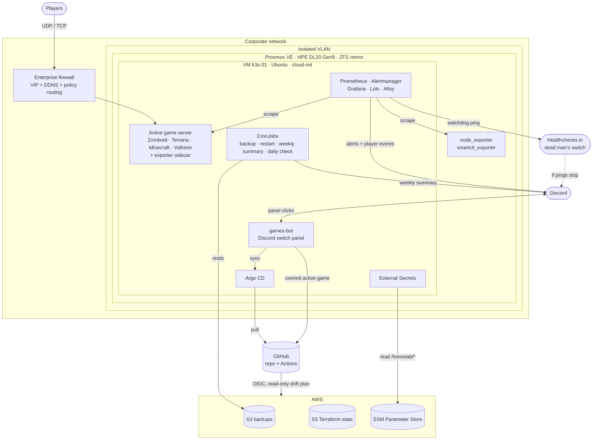
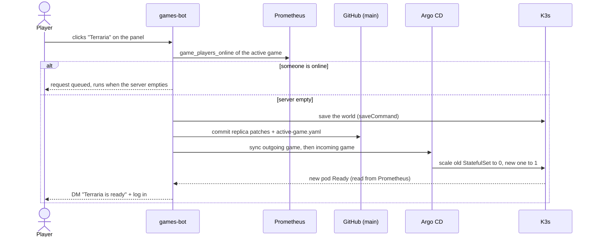

# proxmox-k3s-platform

[](https://github.com/iagorp6/proxmox-k3s-platform/actions/workflows/ci.yml)

A single-node, production-style platform on a recycled **HPE ProLiant DL20 Gen9**, managed entirely as code.

**Proxmox VE** is provisioned with **Terraform** and **cloud-init**, configured with **Ansible**, and runs **K3s** with **GitOps (Argo CD)**, full **observability** (Prometheus, Grafana, Loki, Alertmanager), **secrets from AWS SSM** via External Secrets, and **encrypted off-site backups on AWS S3**.

The workload is a small **game-server platform** for a group of friends: **Project Zomboid (Build 42)**, **Terraria**, **modded Minecraft** and **Valheim**, one active at a time and switched through Git. The games are the excuse; the platform around them is the point. It is operated like a real service: SLO, alerting with a first-step action in every message, an external dead man's switch, tested restores, and a CI that checks its own tools.

<!-- DASHBOARD_IMAGE -->

---

## Highlights

- **Everything as code.** VM, OS config, cluster, workloads, dashboards, alert rules and AWS resources live in this repository.
- **GitOps.** Argo CD (app of apps) reconciles the cluster from `main`: merge is deploy for configuration and third-party charts (validated in CI first), while game servers sync only through the game switch, which checks for players and saves the world ([ADR 0009](docs/adr/0009-auto-sync-for-third-party-charts.md)).
- **A platform, not a one-off.** Each game is a catalog entry; a generator renders its Service, metrics, backup and Argo CD Application, and switching the active game is a commit made by one command.
- **Custom exporters** (stdlib Python) behind one metric contract: server health, players online and all-time playtime over RCON or REST, plus character deaths parsed from server logs.
- **Player-facing notifications** on Discord: who joined (and who else is online), character deaths, playtime milestones and a weekly summary.
- **Alerting designed to be trusted:** severities mapped to response time, a first-step action in every message, a mute window for the daily restart, inhibition of cascading alerts, and an external dead man's switch.
- **Secrets never in Git:** Bitwarden (humans) → AWS SSM (machines) → External Secrets (cluster), with self-healing Secrets.
- **Backups you can restore:** daily encrypted restic snapshots to S3, restored and checked automatically every month.
- **Reproducible CI:** tool versions pinned and checksum-verified, actions pinned by commit SHA, pinned runner image; Dependabot; a local runner that mirrors CI and verifies the tools themselves.
- **Near-zero cost:** S3 and SSM usage is measured in cents per month.

---

## Architecture



---

## Stack

| Layer | Tools |
|---|---|
| Hardware | HPE ProLiant DL20 Gen9, Xeon E3-1220 v5, 24 GB ECC, 2x 1 TB HDD (ZFS mirror) |
| Virtualization | Proxmox VE |
| Provisioning | Terraform (`bpg/proxmox`, `hashicorp/aws`), cloud-init, remote state on S3 |
| Configuration | Ansible (roles: `k3s`, `gameserver_net`, `host_exporters`, `pve_host`, `auto_updates`) |
| Orchestration | K3s (pinned version, secrets encrypted at rest) |
| GitOps | Argo CD (app of apps) |
| Workloads | Project Zomboid (Build 42), Terraria (TShock), Minecraft (Fabric modpack), Valheim |
| Observability | kube-prometheus-stack, Loki, Grafana Alloy, custom Python exporters |
| Alerting | Alertmanager → Discord (private `#ops` channel for infra, players' channel only when the game or host is down), Healthchecks.io dead man's switch |
| Secrets | Bitwarden, AWS SSM Parameter Store, External Secrets Operator |
| Backup | restic → S3 (encrypted, deduplicated) |
| CI | GitHub Actions: tflint, ansible-lint, kubeconform, promtool, shellcheck, ruff, Trivy; Dependabot and Renovate; weekly Terraform drift plan over OIDC |

---

## Repository layout

```text
terraform/             Proxmox VM (cloud image, cloud-init, DHCP-reserved NIC)
terraform-aws/         S3 (backups + state), least-privilege IAM, SSM parameters, Budgets, GitHub OIDC
ansible/               K3s install, game-server network tuning, host exporters, OS patching
k8s/argocd/            Argo CD install + app of apps (games, platform, monitoring and External Secrets charts)
k8s/games/             One directory per catalog game: game.yaml, StatefulSet, generated manifests
k8s/platform/          Workloads that belong to no game: games-bot, weekly summary, daily health check
k8s/monitoring/        Helm values, alert rules and their tests, generated Grafana dashboard
k8s/external-secrets/  External Secrets Operator + ClusterSecretStore (AWS SSM)
platform/              Active game, platform defaults and the shared game exporter library
apps/games-bot/        Discord bot for self-service game switching (image built and scanned in CI)
scripts/               Generators (games, dashboard, scaffold), game switch, restore drill, local CI runner
docs/                  ADRs, SLO, postmortems, DR runbook, restore drill records, Minecraft modpack installer
```

---

## How it comes together

1. **`terraform-aws/`** creates the state bucket, the backup bucket, scoped IAM users, SSM parameters and a budget alarm.
2. **`terraform/`** creates the VM from an Ubuntu cloud image with cloud-init (user, SSH key, network).
3. **Ansible** installs K3s (artifacts fetched and checksum-verified on the control node), tunes the game network path, and installs exporters on the Proxmox host.
4. **Helm** installs Argo CD, the only release that has to exist before GitOps can start.
5. **Two bootstrap secrets** (the External Secrets AWS credential and the Argo CD deploy key) and one `kubectl apply` of the root app. Argo CD reconciles everything else, including the third-party charts (observability stack and External Secrets, pinned in their Applications, [ADR 0007](docs/adr/0007-helm-releases-under-argocd.md)), and External Secrets restores every Secret from SSM.

Day-to-day tasks are wrapped in a `Makefile`: run `make help` to list them (`make ci` mirrors the GitHub Actions checks locally). Every target that applies something (`plan`, `secrets`, `deploy-*`, `restore-*`) and every Ansible playbook first runs `scripts/require-main.sh`, which stops with the fix when the clone is on another branch, has uncommitted changes to tracked files or is behind `origin/main` (`FORCE=1` skips it in an emergency).

---

## Game platform

Four games share one platform and only one runs at a time: the VM fits a single heavy game, and the group never plays two at once.

| Game | Server | Player data from | Notes |
|---|---|---|---|
| Project Zomboid (Build 42) | SteamCMD init + custom entrypoint | RCON, server logs | Daily restart with in-game warnings |
| Terraria | TShock, image pinned by digest | TShock REST API | Non-root, characters stored on the server |
| Minecraft | Fabric modpack pinned by version ID | RCON | Whitelist plus in-game password authentication |
| Valheim | community-valheim-tools image, pinned by digest | Steam query (A2S), player count only | Same UDP ports as Zomboid; updates itself when nobody is online |

- **Catalog-driven.** Each game declares its name, ports, backup paths and schedule in `k8s/games/<game>/game.yaml`. `scripts/render-games.py` generates the game Service, the metrics Service and ServiceMonitor, the restic backup (ExternalSecret + CronJob) and the Argo CD Application. Only the StatefulSet and the game's own Secrets are hand-written, because that is where games really differ. The dashboard generator, the switch script, the status command and CI read the same catalog (`scripts/catalog.py`), so no script keeps its own list of games. CI fails if a generated file is stale or the catalog is inconsistent, including an active game on a port the edge firewall does not forward (`publishedPorts` in `platform/defaults.yaml`, the one step outside Git).
- **Adding a game is a scaffold.** `make new-game GAME=valheim TITLE=Valheim IMAGE=repo:tag@sha256:... PORT=2456 PROTOCOL=UDP` creates the game directory in `draft` status: catalog entry, namespace, replica patch, a StatefulSet with the `server` container and the exporter sidecar wired in, and a three-line exporter on top of a shared library (`platform/exporter/gameexporter.py`, copied into each game by the generator because kustomize only reads files inside the game directory). The library owns the metric contract, persisted playtime and `/metrics`; a driver decides how the server is measured: `listen` reports `game_up` from the game port's socket in `/proc/net` (no connection, so no player slot taken), and `rcon` speaks Source RCON with a players command and a regex (`--driver rcon --rcon-port ... --players-command ... --players-regex ...`), which covers Minecraft, Zomboid, Palworld, ARK or CS2 without new code, and `a2s` asks the Steam query port for the player count (`--driver a2s --query-port ...`, used by Valheim, whose query carries no player names). The library is unit-tested against fake RCON and A2S servers and real sockets. Flip it to `active`, run the generator, and the game gets its Service, backup, Argo CD app, alerts, bot button and dashboard rows. CI scaffolds a throwaway game on every run to keep the template valid.
- **Switching is a commit.** `make switch-game GAME=terraria` refuses to run while anyone is online, saves the world, flips the replica patches and `platform/active-game.yaml`, commits, syncs the outgoing game first and the incoming one second, and announces on Discord when the new server is ready. Git always says what is running. A change to the running game (a whitelist entry, a new image digest) goes through `make sync-game GAME=minecraft`, which runs the same player check and save before the Argo CD sync instead of a blind Sync in the UI.
- **Players switch on their own.** A Discord bot keeps one panel in `#games` with the active game, players online and one button per game ([ADR 0006](docs/adr/0006-discord-self-service-switch.md)). It runs the same Git flow from inside the cluster, with a deploy key read through External Secrets, and refuses (queuing the request) while anyone is still playing. The queue and the cooldown live in a ConfigMap the bot writes itself (outside Git, so Argo CD's self-heal does not undo them), so a restart of the bot pod does not drop a waiting request:


- **One metric contract.** The exporter sidecar of each catalog game exposes `game_up`, `game_players_online`, `game_player_online{player}` and `game_player_playtime_seconds_total{player}`, whatever the protocol behind it, so a new game reuses the same dashboard panels, alerts and Discord notifications.
- **Alerts follow the desired state.** `GameDown` compares `kube_statefulset_replicas` with ready replicas, so a stopped game never pages. It is generated from the catalog together with `GameUnresponsive` (pod ready, server not answering the exporter), `GameExporterMissing`, `GameRestarted` and `GameMemoryHigh`, so every new game gets the same alert set without anyone editing a rule.
- **Players get a one-file installer.** For the modded Minecraft server, `docs/minecraft/install-cobbleverse.ps1` installs the exact modpack version the server runs, downloading every mod from the official CDN and verifying its SHA-512.
- **Decisions are written down** in `docs/adr/`: why not Agones or a game panel, why Git owns the active game, and why a generator replaced Kustomize components.

Project Zomboid, the first game, is in the catalog and on the same contract as the others. Its exporter adds a few series under the same prefix (`game_player_deaths_total`, `game_player_milestone_hours`, last death time and hours survived), which feed the death and milestone events.

### Project Zomboid, built for operability

- **StatefulSet** with an init container that installs or updates the server via SteamCMD and writes the server config from ConfigMap + Secrets.
- **Entrypoint built for operability:** server commands go through a console FIFO held open by the shell, so `save`, `quit` and in-game announcements can be sent from `kubectl exec`, CronJobs and the `preStop` hook. When the game process dies, the container exits and Kubernetes restarts it, instead of leaving a "Running" pod with no game.
- **Daily restart** at 06:00 with in-game warnings, and a graceful `save` before every shutdown.
- **Launcher arguments are filtered from logs** at the source and again in the log pipeline, so credentials never reach Loki.

---

## Player notifications

| Event | Discord message |
|---|---|
| Join | 🟢 *iago joined* · 3/6 online: iago, joao, maria (mentions an opt-in `@Zomboid` role) |
| Leave | 🔴 *iago left* · session of 2h26m |
| Character death | 💀 *iago died* · survived 34 in-game hours |
| Playtime milestone | 🏆 *joao reached 50 hours on the server* |
| Weekly summary | 📊 Hours played, ranking with medals, peak concurrency, deaths, availability |
| Daily health check | ✅ *Tudo OK* or ⚠️ the list of what needs attention: firing alerts, game up, last backup age, free disk, pod restarts, host and VM uptime, pending host patches (a failed Prometheus query is reported too, never silence) |

<!-- DISCORD_IMAGE -->

Joins (the role is pinged only for whoever opens the server) and the weekly summary work for every game; deaths and playtime milestones are Project Zomboid only for now.

**How it works:** the exporter sidecar polls the server over RCON every 15 seconds, keeps all-time playtime per player on the game volume (seeded from Prometheus history on first start), and tails the server's PerkLog for deaths. Prometheus rules turn those metrics into events; Alertmanager routes them to Discord with their own templates, separate from operational alerts. A CronJob builds the weekly summary from PromQL queries. No extra services were added for any of this.

---

## Observability

The **GamesPlatform** dashboard covers every game on the platform and is Grafana's home page. The first screen answers "is it up, and who is playing?"; everything else sits in collapsed rows:

- **Now:** active game, server status, players online, oldest backup, active alerts, and an availability strip showing every outage in the period.
- **Players:** players over time, a per-player session timeline, and a table with playtime (24h, 7d, 30d, all time), deaths and last seen.
- **Game server resources:** memory against the container limit, CPU against the VM's vCPUs, unexpected restarts.
- **SLO** (collapsed): 28-day availability against the 99% objective, error budget left and burn rate over 30 minutes, 6 hours and 3 days ([docs/slo.md](docs/slo.md)).
- **Restore drills** (collapsed): age of the last passing drill per game and every run in the last 30 days.
- **Host hardware** (collapsed): SMART, ZFS pool, ECC errors, disk temperature, free space, host RAM, disk load (busy time, IOPS, write latency), ZFS errors and last scrub.
- **Logs and alerts** (collapsed): firing alerts, server warnings and errors.

The ~25 dashboards that ship with kube-prometheus-stack live in a separate **Kubernetes** folder, out of the way.

The dashboard JSON is **generated** by `scripts/build-dashboard.py`, so it is reviewable in a pull request; CI fails if the committed YAML drifts from the generator.

---

## Alerting

| Severity | Meaning | Repeat |
|---|---|---|
| `critical` | Act now (server down, disk failing, no backup in 26h) | every 2h |
| `warning` | Act today (memory pressure, unexpected restart, reallocated sectors, OOMKilled container) | every 12h |
| `info` | Record only, never notifies (player events have their own route) | n/a |

- **Every message carries a first-step action**, the command to run at 3 a.m.
- **Mute windows per game:** a game declares `alerts.muteDuring: <time_interval>` in its `game.yaml`, its generated alerts carry a `mute` label, and Alertmanager silences that label during the window (the daily restart, for Project Zomboid). `render-games.py --check` fails if the window or its route does not exist.
- **Two channels:** infra alerts and the daily health check go to a private `#ops` channel, so friends never see a disk warning between deaths and milestones. Only what players feel (game down, game not answering, host down) also goes to their channel, in plain words and without the command; every other critical stays in `#ops`. Criticals repeat every 6 hours and warnings once a day, so a stuck alert does not flood the channel.
- **Inhibitions:** with the host down, disk/ZFS/ECC alerts stay silent; with a game down, its restart, memory and missing-metrics alerts stay silent.
- **GitOps is watched too:** Argo CD and External Secrets export metrics, so an Application that stays Degraded, an auto-synced app that drifts from `main`, or an ExternalSecret that stops syncing from SSM raises a warning instead of waiting for someone to open the UI.
- **SLO burn-rate alerts:** one SLO (the active game answers 99% of the time over 28 days, [docs/slo.md](docs/slo.md)) with multiwindow burn-rate alerts from the SRE Workbook: 6x over 6h and 30m, 1x over 3 days and 6h, and budget exhausted. Recording rules feed both the alerts and the dashboard, and promtool tests simulate outages, a normal game switch and a slow 3-day burn.
- **Dead man's switch:** Alertmanager's always-firing `Watchdog` pings Healthchecks.io every minute. If the whole VM or host goes down, the external service notices the silence and alerts Discord through its own integration. If Alertmanager is up but cannot deliver to Discord (webhook deleted or rotated), `AlertmanagerFailedToSendAlerts` inhibits the `Watchdog`, so the same check goes red instead of every alert failing silently.

---

## Backup and disaster recovery

| Layer | Frequency | Protects against |
|---|---|---|
| In-game autosave | Every 10 minutes | Server crash |
| Built-in game backups | On start and on version change | Corrupted save, bad update |
| ZFS mirror on the host | Continuous | One failed disk ([replacement](docs/disk-replacement.md)) |
| restic → S3 | Daily, 7 daily + 4 weekly | Both disks, VM or host loss |

The backup bucket is versioned: restic needs `DeleteObject` to prune, so on its own the credential that writes backups could also erase them. With versioning, anything deleted or overwritten stays recoverable for 30 days, and the restic policy has no permission over object versions, versioning or lifecycle. Daily backups only run `forget`; a weekly job runs `prune` once (it takes an exclusive lock and rewrites packs in S3, so three prunes a day could hold the lock while the next game's backup waited) and then `restic check`, which reads the repository metadata and a random 5% of the data packs. A warning fires if either fails, so corruption shows up before a restore needs it.

Before each snapshot, an init container runs the game's `saveCommand` from the catalog (`save-all flush` for Minecraft) through a ServiceAccount that may only `exec` into that one pod, so the world on disk is consistent when restic reads it. The `kubectl` binary it uses is verified against a SHA-256 pinned in `platform/defaults.yaml`. If the server is stopped, the backup takes the last save on disk.

`make restore-drill GAME=terraria` proves the backup comes back without touching the game: it restores the latest snapshot from S3 into a temporary PVC with the same image and Secret as the backup CronJob, checks that every backed-up path came back with content (plus the world file the catalog names in `backup.verify`), prints the snapshot age, size and timings, and deletes everything. With `RECORD=1` the result is appended to [docs/restore-drills.md](docs/restore-drills.md). The same drill also runs on its own: the generator gives every game a monthly `<game>-restore-drill` CronJob (day of the month derived from the game name, so the games don't pull from S3 at the same time) that restores into a capped `emptyDir`, runs the same checks and wipes the data at the end. A failed run raises `KubeJobFailed`, and `RestoreDrillStale` fires when a game goes 35 days without a passing drill, including a drill that never passed. `make restore-game GAME=minecraft` is the real restore: same Job, written into the game's own volume, only while the server is stopped, with the current world moved aside to `<path>.pre-restore-<date>` instead of deleted. A full rebuild (Proxmox on a ZFS mirror, VM from Terraform, cluster from Ansible, workloads from Argo CD, Secrets from SSM, world from S3) is scripted step by step in the [DR runbook](docs/dr-runbook.md); the measured RTO will be published here after the drill.

---

## Security

- IAM users scoped to a single bucket (backup) and a single SSM path, read-only (secrets); their long-lived access keys are checked weekly and must be rotated before 180 days ([runbook](docs/key-rotation.md))
- GitHub Actions reaches AWS through OIDC with a short-lived role, no stored keys; only `main` can assume it, and explicit denies keep it away from backup objects and game secrets
- The IAM guarantees above are tested, not just commented: `terraform-aws/tests/security.tftest.hcl` runs in CI with mocked providers (no credentials) and fails if a PR lets restic touch object versions or bucket settings, widens External Secrets beyond reading `/homelab/*`, lets anything but `main` assume the drift role, or drops one of its explicit denies
- Terraform state bucket: versioned, encrypted, public access blocked, TLS-only, `prevent_destroy`, native S3 locking
- Kubernetes Secrets encrypted at rest and delivered by External Secrets; nothing secret in Git
- Container images pinned by digest; chart, tool and action versions pinned
- Game server and sidecars run as non-root; RCON reachable only inside the pod
- NetworkPolicies (enforced by K3s's embedded controller): each game namespace accepts only its game ports and the Prometheus scrape on the metrics port, and reaches out only to cluster DNS, the Kubernetes API and the public internet (no private ranges, so a compromised game server cannot reach the host or the home network), generated from `game.yaml`; the `platform` namespace accepts nothing
- A push to `main` has a bounded blast radius ([ADR 0010](docs/adr/0010-guardrails-outside-autosync.md)): every Argo CD Application sits in an AppProject limited to its repositories, namespaces and cluster resources, the `default` project is empty, and namespaces enforce Pod Security (`restricted` for the platform and most games). Projects and namespaces are applied by hand, outside autosync, and CI checks that every manifest and chart fits its project and Pod Security level
- CI fails on any committed secret (Trivy); environment-specific values live in git-ignored local files
- The game VM sits in an isolated VLAN with no route to the internal network
- OS patching: the VM installs security updates on its own (unattended-upgrades, security pockets only) and reboots only when a package asks for it, in a weekly Monday 04:30 window that saves the running game first and is muted in Alertmanager. The Proxmox host is patched by hand (`playbooks/pve-upgrade.yml`, optional reboot) because its reboot takes everything down; alerts fire when host security updates or a reboot have been pending for more than 7 days. K3s upgrades (`playbooks/k3s.yml`) save the games and take a ZFS snapshot of the VM on the host first, abort if the snapshot fails, and delete it once the node is Ready on the new version: a bad upgrade rolls back with one `qm rollback`

---

## CI

Every push runs Terraform `fmt`/`validate`/`tflint` for both stacks, `terraform test` of the AWS security invariants, `ansible-lint`, `kubeconform` (including CRDs), drift checks for the generated dashboard and game manifests, alert rule tests, `shellcheck` on every tracked script, Python syntax and `ruff`, a `helm template` of every third-party chart with the repository's values, a check that every Argo CD Application and chart fits its AppProject and every pod its namespace's Pod Security level, and Trivy (secrets, and misconfigurations that fail the build unless justified in `.trivyignore.yaml`).

- **Reproducible:** the runner image and the versions of Terraform, tflint, kubeconform, Trivy, promtool and ansible-lint are pinned; downloaded binaries are verified by SHA-256 (`scripts/install-ci-tools.sh`, shared by CI and the local runner) and GitHub Actions are pinned by commit SHA. Dependabot proposes upgrades to actions, Terraform providers, the bot's base image and its Python dependencies (hash-pinned) weekly; Renovate (`renovate.json`) covers what Dependabot cannot see: image digests in the manifests (grouped into one weekly PR, generated files included so the drift check stays green), Helm chart versions, K3s patch releases and the pinned `kubectl` (CI checks its SHA-256 against dl.k8s.io and prints the fix, since Renovate cannot compute it). Platform images carry a semver tag next to the digest (`restic/restic:0.19.1@sha256:...`), so an update PR says which version it brings. Nothing auto-merges.
- **Security findings are a gate, not a report:** any HIGH or CRITICAL misconfiguration fails CI. The few accepted ones (exec for the save hook, writable root filesystem for game servers, SSE-S3 instead of a paid KMS key) are listed in `.trivyignore.yaml`, scoped to the files where they apply, each with its reason, so accepting a new one is a reviewed change.
- **Charts are checked before merge, which is when they deploy:** the observability, External Secrets and Argo CD charts only render in the cluster, so `scripts/check-charts.py` renders each one at its pinned version with the repository's values and validates the output, catching a broken value or an incompatible chart upgrade in the pull request.
- **Alert rules are tested like code:** `promtool` validates every rule and runs unit tests with synthetic series (`k8s/monitoring/tests/`): a stopped game must not page, a missing backup must, and each alert must fire with the expected labels and text. A lint also fails the build if a `critical` or `warning` alert has no first-step action.
- **The code that changes production is unit-tested:** stdlib `unittest`, no extra dependencies. The Discord bot's decisions (role check, players-online lock, cooldown, one-request queue with expiry, no two switches at once, switch steps) run against a minimal fake `discord` module; `switch-game.py` runs for real in a temporary Git repository with a local origin, checking the replica patches, the commit message, that only allowed paths are ever committed and every refusal; the daily health check is fed canned Prometheus answers, including a Prometheus outage that must become a message, never silence.
- **Weekly drift detection:** `terraform-drift.yml` assumes a read-only AWS role via OIDC and runs `terraform plan` on `terraform-aws/`. It fails, and GitHub sends an e-mail, when AWS diverges from the code (a change made outside Terraform or a forgotten `apply`). The repository is public, so the job logs only the address and action of each changed resource, never values. The same run lists the access keys of the IAM users and fails when an active key is older than 180 days or a user has more than one key.
- **Same checks locally:** `scripts/ci-local.sh` runs the identical checks on a clean copy of the tracked files (so local secrets cannot leak into the scan) and refuses to run if any tool fails a version smoke test.

---

## Engineering notes

Real problems hit while building and operating this, and how they were solved. The incidents with player or monitoring impact have full blameless postmortems (timeline, root cause, action items) in [docs/postmortems/](docs/postmortems/).

**UEFI boot loop on the HPE B140i.** The OS installed fine but the server always fell through to PXE. The embedded "Dynamic Smart Array" exposes only its own logical drives to UEFI. Switching the controller to AHCI and letting ZFS manage the disks fixed it.

**DHCP reservation ignored.** `systemd-networkd` identifies itself with a DUID by default, while the DHCP server matches reservations by MAC. Setting `dhcp-identifier: mac` in the cloud-init network config fixed it.

**Restricted egress.** The VM could reach GitHub's API but not its release CDN. The Ansible role downloads K3s artifacts on the control node, verifies their checksums and pushes them to the VM.

**CGNAT and asymmetric routing.** Inbound traffic arrived through one ISP while replies left through another behind CGNAT. A policy route keeps the game ports symmetric.

**Stripe to mirror without a reinstall.** The host was installed on a two-disk ZFS stripe, and the plan was to fix it during a full rebuild. OpenZFS device removal made it a live operation of a few minutes: `zpool remove` evacuated one disk onto the other (13.9 GB in 2 minutes) and `zpool attach` mirrored it back, with the game server running. The disk-load panels and a fio benchmark captured before and after showed the cost: sequential writes dropped from 179 to 145 MB/s and the fsync p99 doubled (40 to 79 ms), while random reads were unchanged. With the disks idle over 80% of the time, that was worth trading for surviving a disk failure ([ADR 0005](docs/adr/0005-host-recovery-by-rebuild.md)).

**"Loading the world" never finished.** Packet captures showed large UDP packets retransmitted forever: fragments were dropped on the path. The game's RakNet transport negotiates MTU at connect time, so an `iptables` length match drops oversized handshake probes and forces a smaller MTU. Codified in the `gameserver_net` role.

**A "harmless" hardening took the server down for an hour.** Removing the default admin account looked like a security win, but the server requires it at startup and, when missing, blocks on an interactive prompt with no TTY. The pod stayed `Running` with no game. The alert fired; the fix was to always pass the admin password at boot (from SSM), filter launcher arguments from logs, and restructure the entrypoint so the container exits when the game does.

**Health probes filled the server.** Terraria counts every TCP connection as a player slot, so Kubernetes TCP probes slowly exhausted the slots until nobody could join. The probes now read `/proc/net/tcp` for a listening socket instead of opening a connection.

**A stopped game kept Argo CD "Progressing".** A LoadBalancer Service with no ready endpoints never gets an address from K3s ServiceLB, and Argo CD waits for one forever. A custom health check treats game Services of stopped games as healthy, and an alert covers the real failure mode: a ServiceLB pod stuck pending because of a port conflict.

**Grafana was OOMKilled 15 times in a day, silently.** A heavier dashboard made it obvious: the memory limit had been too tight from the start, and no alert covered monitoring components. The limit was raised based on measured usage, and a cluster-wide `ContainerOOMKilled` alert now covers every workload.

**A linter that passed without running.** A WSL crash during installation left the local `ansible-lint` as an empty file: it exited 0 and printed nothing, so local checks passed while CI failed. CI also drifted because it installed the latest linter on every run. Fixes: pin every tool version, and make the local runner smoke-test each tool before trusting its result.

**Applying yesterday's repo.** Three times the laptop clone was on an old Dependabot branch or behind `origin/main`: a deploy applied old Helm values, `terraform init` missed a provider bump, and a benchmark ran without the morning's fixes. Each looked like a new bug. Every `make` target that applies something and every playbook now refuse to start from a stale clone.

**Empty secrets.** A password-manager CLI returned nothing for a missing item, creating empty Secrets. Fail-fast guards came first; External Secrets with SSM as the source of truth removed the manual step entirely.

---

## Cost

| Item | Monthly |
|---|---|
| S3 (backups + state) | cents |
| SSM Parameter Store (standard), KMS (AWS managed key) | free |
| Healthchecks.io, GitHub Actions, Dependabot | free tier |
| Hardware | recycled |

A Budgets alarm fires above USD 1/month. The size of the restic repository, which is what drives the bill, is checked every week by the `restic-check` CronJob and alerts on Discord above 15 GiB (`ResticCheckFailed`).

---

## Roadmap

- [x] GitHub Actions to AWS via OIDC, used for weekly drift detection
- [x] Migrate to the non-deprecated `proxmox_download_file` resource
- [x] Renovate running for image digests, chart versions, K3s and kubectl (Mend app, weekly Monday PRs, [Dependency Dashboard](https://github.com/iagorp6/proxmox-k3s-platform/issues/100))
- [x] Third-party Helm releases (monitoring, External Secrets) managed by Argo CD
- [x] Automatic security patching on the VM, pending-patch alerts on the host
- [ ] Timed full DR drill and published RTO (rebuild strategy in [ADR 0005](docs/adr/0005-host-recovery-by-rebuild.md))
- [x] Host pool on a ZFS mirror, converted in place (`zpool remove` + `zpool attach`, no reinstall); [disk replacement](docs/disk-replacement.md) documented
- [ ] Custom game-server image built in CI

---

## Author

**Iago Rosa Pinheiro** · Technical Support Engineer moving into DevOps / SRE / Platform Engineering
[LinkedIn](https://linkedin.com/in/iagorp6) · [GitHub](https://github.com/iagorp6)
